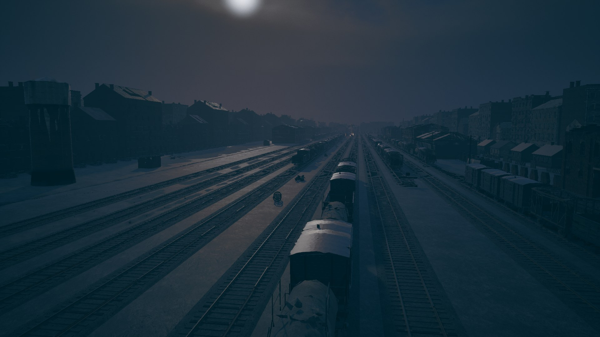
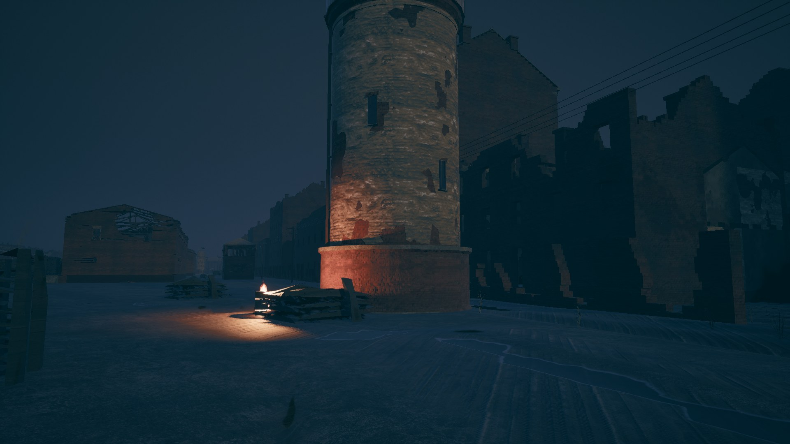
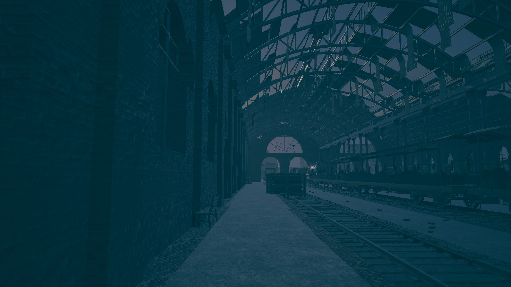
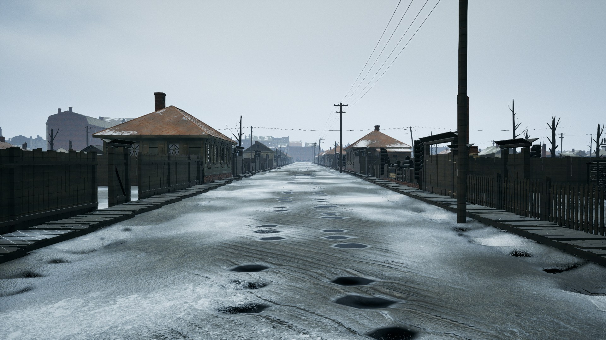
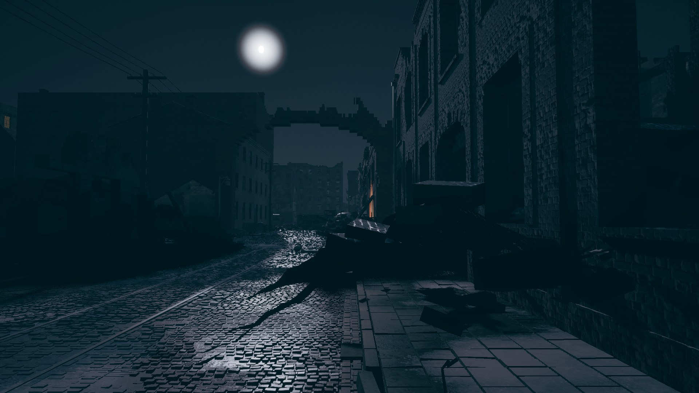

# DOMOY
### *домой · homeward*

**A story-driven, first-person tactical shooter set in the Battle of Stalingrad, 1942–1943.**

*In development · Unreal Engine 5 · PC*

---

> *He keeps one word when everything else is gone.*

## The story

Stalingrad, 1942. A farmer from the steppe is conscripted to defend the city closest to his home.

He doesn't fight in a regiment. He fights beside three people outside any chain of command: a factory worker turned sniper from his own district, a silent infantryman who survived the first German advance, and a talkative Ukrainian who can find or make almost anything.

They aren't heroes. They're four people trying to keep each other alive in a city coming apart around them, and holding on to one word for why.

**Домой. Homeward.**

## What it is

- **A short, linear campaign.** Every mission matters, and none of it is filler.
- **A small cast you come to know.** Pyotr, Ilya, Klava and Sverchok, each written to be remembered by how they act, not what they say.
- **A city that grows.** Not an open world. Each mission opens a new piece of Stalingrad, connected to the last, until a small part of the city holds everything that happened to them there.
- **Evenings by the fire.** Between missions the group comes back to their base for talk or silence. What's said there changes as the story does.
- **Restraint.** The violence is never there for its own sake. When something happens, it changes something.
- **Both sides of the war.** The enemy is seen as human, through moments and things left behind, and the game leaves you to decide what you think.

## Screenshots

| | |
|---|---|
|  |  |
| *The water tower, rail yard* | *The station's train shed* |
|  |  |
| *The long walk north* | *Downtown, under the moon* |

## How it's being made

Domoy is a solo project, built in the evenings and on weekends around a day job and a family.

- **Engine:** Unreal Engine 5
- **Art:** Blender, MetaHuman, motion capture
- **Combat:** squad companions you can give orders to, and German soldiers who flank, suppress, push and fall back, with no cheating and no wallhacks.
- **[Cerebro](https://github.com/CoderofVibes/Cerebro):** my own 3D combat replay lab. Every playtest is recorded and can be replayed as a hologram, so I can see exactly why a fight went the way it did.

### A note on voices

Voice work uses AI tools from ElevenLabs:

- **Story and cutscene lines** are performed by me and converted into each character's voice with ElevenLabs' voice changer, so the performance (timing, pauses, emotion) is mine.
- **Combat call-outs**, including the German soldiers' shouts, are generated with ElevenLabs text to speech in voices designed for each character. The German lines were checked by a native speaker.
- **No real person's voice is cloned.**

This will also be disclosed on the game's Steam page.

## Status

Early development. Several missions are built and being played through, combat is being tuned, and the characters are being brought to life one at a time.

This repo is a **dev log and showcase only**. The game's source isn't public.

## Follow along

- **X:** [@CoderofVibes](https://x.com/CoderofVibes)
- **Steam:** *wishlist coming soon*
- **Cerebro:** [the combat lab behind the fights](https://github.com/CoderofVibes/Cerebro)

---

*For those who never made it home.*

